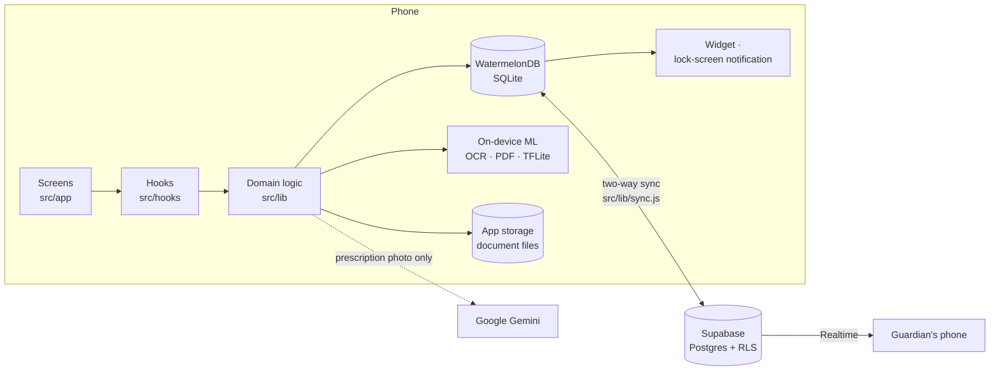

<div align="center">

# AntiRog

**An offline-first personal health companion for iOS and Android.**

Keep every prescription, dose, hospital visit and lab result on your phone, check medicines against each other, identify loose pills with the camera, and carry an Emergency Medical ID on your home screen and lock screen. Built with Expo, React Native, WatermelonDB and Supabase, with OCR and pill recognition running on the device.


</div>

> [!IMPORTANT]
> AntiRog is a personal record-keeping tool, **not a medical device and not medical advice**. Interaction checks, pill identification and lab value flags are aids that can be wrong. Always confirm with a doctor or pharmacist.

---

## Table of contents

1. [Overview](#overview)
2. [Features](#features)
3. [Tech stack](#tech-stack)
4. [Architecture](#architecture)
5. [Project structure](#project-structure)
6. [Getting started](#getting-started)
7. [Supabase backend setup](#supabase-backend-setup)
8. [Running and building](#running-and-building)
9. [Data model](#data-model)
10. [On-device intelligence and native code](#on-device-intelligence-and-native-code)
11. [Privacy and security](#privacy-and-security)
12. [Development guide](#development-guide)
13. [Troubleshooting](#troubleshooting)
14. [Known limitations](#known-limitations)
15. [Roadmap](#roadmap)
16. [License](#license)

---

## Overview

AntiRog brings a patient's medical life into one app that keeps working without a connection:

- **Offline-first.** Every record is written to a local SQLite database (WatermelonDB) first and synced to Supabase in the background when a connection is available. Nothing waits on the network.
- **On-device by default.** Lab report OCR, PDF rendering, pill identification and drug interaction checks all run on the phone. Report images and camera frames never leave the device.
- **Shared on your terms.** A family member can follow your medications and doses through Guardian Sync, read-only, and only after you hand them an invite code.
- **Ready for emergencies.** A Medical ID (blood type, allergies, conditions, emergency contact) can be shown on a home screen widget and, on Android, as a silent lock-screen notification.

## Features

The app has five tabs.

### Medications

- **Prescription vault**: add medicines by hand or from a photo of a prescription (every medication and dosage on the page is extracted and reviewed before saving).
- **Daily reminders** per medication, scheduled as local notifications that work offline.
- **Dose logging**: mark today's doses as taken or skipped; unlogged doses count as missed once the day is over.
- **Interaction checks** against a curated, locally stored table of high-risk drug–drug pairs, run on the device whenever a medication is added or scanned. High-risk medicines are flagged.
- **Drug profiles** with common side effects for well-known medicines.

### Scan

- **Pill identifier**: point the camera at a loose pill. A TFLite image classifier runs on every few camera frames on the device, locks on once the same result is confident over several frames, and checks it against your medications.
- **Scan-to-log**: if the identified pill is one of your medications and a dose is due, log it in one tap.
- **Pill history**: every identification is saved (name, confidence, time) and listed as *Previously Identified Pills*.

### Visits

- **Hospital and clinic visits** with facility, doctor, reason and notes.
- **Documents** (prescriptions, lab reports, other) attached to a visit as photos or PDFs. Files stay on the phone; only their records sync.
- **Medications added from a visit** are linked back to it.

### Reports

- **Medications report**: 30-day adherence with a chart, and a doctor-ready PDF (active medications, adherence and visit log) generated on the phone and shared through the system share sheet.
- **Tests report**:
  - Scan or upload a lab report (photo, image or **PDF**) and read the values with on-device OCR.
  - 13 biomarkers are recognised: blood pressure, fasting and random glucose, HbA1c, total cholesterol, LDL, HDL, triglycerides, hemoglobin, creatinine, TSH, vitamin D and vitamin B12. Values are converted to one canonical unit and flagged low / normal / high against generic adult ranges.
  - **Trend charts** per biomarker over time.
  - **Lab Reports** list of every report, whether scanned here or attached to a visit. Deleting a report removes its file, its record and the values saved from it.

### Profile

- **Medical ID**: full name, date of birth, blood type, allergies, chronic conditions and emergency contact, with an opt-in **Show on Home Screen & Lock Screen** switch.
- **Guardian Sync**: create an invite code for a family member, see who follows you, and remove them. Followers see your medications and today's doses live (Supabase Realtime) but can never change anything or see your visits.
- **People you look after**: link to a patient's code and monitor their doses, with an alert when someone needs attention.
- **Appearance** (system / light / dark), **Sync now**, and **Sign out** (with a warning if changes haven't been backed up yet).

### Home screen and lock screen

- **Medical ID widget** (iOS and Android). On Android it is a fixed 3×2 card; tapping it opens AntiRog. On iOS it is also available on the lock screen.
- **Android lock-screen notification**: a silent, ongoing notification with name, age, blood type, allergies, conditions and emergency contact, shown while the Medical ID switch is on.

### Design system

A custom **neumorphic** UI (raised cards, pressed-in wells, soft shadows) in light and dark themes, with custom confirmation dialogs (`neu-alert`) and bottom-sheet menus (`neu-sheet`) instead of system alerts.

## Tech stack

| Area | Technology |
| --- | --- |
| Framework | [Expo SDK 58](https://docs.expo.dev/), React Native 0.88 (New Architecture, Hermes), React 19.3 with the React Compiler |
| Language | TypeScript (strict) |
| Navigation | [Expo Router](https://docs.expo.dev/router/introduction/) with file-based routes and native tabs |
| Styling | NativeWind 4 (Tailwind CSS) and a custom neumorphic component library |
| Local database | [WatermelonDB](https://watermelondb.dev/) on SQLite (JSI) |
| Backend | [Supabase](https://supabase.com/): Postgres, Auth, Row Level Security, Realtime |
| Camera and ML | `react-native-vision-camera` 5, `react-native-vision-camera-resizer` (GPU), `react-native-fast-tflite`, `react-native-worklets` |
| OCR | `expo-text-extractor` (Apple Vision / Google ML Kit) plus a local PDF-rendering native module |
| Prescription reading | Google Gemini (`@google/genai`) |
| Native UI | `@expo/ui` (SwiftUI / Jetpack Compose), `expo-widgets` |
| Charts | `react-native-gifted-charts`, `react-native-svg` |
| Platform services | `expo-notifications`, `expo-print`, `expo-sharing`, `expo-file-system`, `expo-image-picker` |
| Builds | EAS Build and development builds; Continuous Native Generation (no committed `ios/` or `android/`) |

## Architecture



**Offline-first sync.** Screens read and write WatermelonDB only. `src/lib/sync.js` implements WatermelonDB's sync protocol against Supabase:

- Pull uses a server timestamp (`sync_now()`) taken before reading changes, and pages through rows changed since the last pull, filtered to the signed-in user.
- Push checks for conflicts first (any record changed on the server since the last pull aborts the push so the next sync pulls first), then upserts.
- Deletions are **soft**: a `deleted_at` timestamp bumps `last_modified_at` through a trigger, so other devices learn about them.
- Sync runs on launch, when the app returns to the foreground, after local writes, and from *Profile › Sync now*. It never throws; offline is reported, not raised.

**Account isolation.** The local database belongs to one account. Signing out wipes it (records, reminders, document files, widget and lock-screen notification) once every subscribed screen has unmounted, and a different account signing in triggers the same wipe before any data is shown.

**Files stay local.** Document and report files are copied to `visit-documents/<record id><ext>` in app storage. Only metadata syncs, so on another device the record appears and the UI says the file is stored elsewhere.

## Project structure

```text
AntiRog/
├── src/
│   ├── app/                     # Expo Router routes (every file is a screen)
│   │   ├── _layout.tsx          # Root stack, auth guard, dialog and sheet hosts
│   │   ├── sign-in.tsx
│   │   ├── add-medication.tsx   # Modal: manual entry or prescription photo
│   │   ├── pill-scanner.tsx     # Full-screen camera
│   │   └── (tabs)/              # Medications · Scan · Visits · Reports · Profile
│   ├── components/              # UI, incl. neu.tsx (design system), neu-alert, neu-sheet
│   ├── hooks/                   # Data and lifecycle hooks (live WatermelonDB queries, sync, reminders)
│   ├── lib/                     # Domain logic: sync, OCR, report parser, interactions, adherence, …
│   │   └── pill-model/          # Pill classifier config, labels, decoding
│   ├── widgets/                 # Medical ID widget (iOS SwiftUI / Android Compose layouts)
│   ├── theme/                   # Neumorphic palette, shadows, navigation themes
│   └── constants/
├── database/                    # WatermelonDB schema (v10), migrations and models
├── modules/
│   └── pdf-renderer/            # Local Expo native module (Swift + Kotlin): PDF pages → images
├── plugins/                     # Config plugins (WatermelonDB JSI, ML Kit model, widget tap, shaders)
├── supabase/migrations/         # Server schema, triggers and RLS policies
├── assets/                      # Icons, fonts, images, models/ (TFLite)
├── patches/                     # patch-package patches (applied on install)
├── app.json                     # Expo config and plugins
└── AGENTS.md                    # Conventions for AI coding agents working in this repo
```

## Getting started

### Prerequisites

- **Node.js 20+** and npm
- **A development build**. Expo Go is not supported: the app uses native modules that Expo Go doesn't include (WatermelonDB, Vision Camera, TFLite, widgets and the local PDF module).
- **Android:** Android Studio with an SDK, **NDK 27.1.12297006** (used to compile the camera resizer's shaders), and a device or emulator (Android 8.0 / API 26 or newer). On-device pill scanning needs Android 9+ with Vulkan.
- **iOS:** a Mac with Xcode, or [EAS Build](https://docs.expo.dev/build/introduction/) for cloud builds.
- **A Supabase project** (free tier is enough) and a **Google Gemini API key** (only for reading prescription photos).

### 1. Install

```bash
git clone <your-repo-url> AntiRog
cd AntiRog
npm install            # also applies patches/ via patch-package
```

Add new dependencies with `npx expo install <package>` (not `npm install`), so versions match the Expo SDK.

### 2. Configure environment variables

Create `.env` in the project root:

```bash
EXPO_PUBLIC_SUPABASE_URL=https://<project-ref>.supabase.co
EXPO_PUBLIC_SUPABASE_ANON_KEY=<supabase-anon-key>
EXPO_PUBLIC_GEMINI_API_KEY=<gemini-api-key>
```

`.env` is git-ignored. Restart the dev server after changing it. See [Privacy and security](#privacy-and-security) about the Gemini key.

### 3. Set up the backend

Follow [Supabase backend setup](#supabase-backend-setup) **before** the first run. Sync fails while any table the app pulls from is missing.

### 4. Build and run

```bash
npx expo run:android   # or: npx expo run:ios
```

This generates the native projects, builds a development build, installs it and starts Metro. After that, day-to-day work only needs `npx expo start` until a native dependency or config plugin changes.

## Supabase backend setup

Run these in the Supabase SQL editor (or with the Supabase CLI), **in this order**:

1. **Server contract**: the SQL in the comment at the top of [`src/lib/sync.js`](src/lib/sync.js). It creates `public.prescriptions`, the `public.sync_now()` timestamp function and the `prescriptions_touch` trigger. It isn't a migration file yet, so it has to be run once by hand.
2. **Migrations** in [`supabase/migrations/`](supabase/migrations), oldest first:

| Migration | Adds |
| --- | --- |
| `20261108000000_guardian_sync.sql` | Owner and guardian RLS on prescriptions, `dose_events`, `guardian_links`, invite codes, Realtime publication |
| `20261112000000_visits.sql` | `visits`, `visit_documents`, `prescriptions.visit_id` |
| `20261116000000_lab_results.sql` | `lab_results` |
| `20261117000000_report_links_and_scanned_pills.sql` | `lab_results.document_id`, `scanned_pills` |
| `20261117120000_emergency_profile.sql` | `emergency_profile` |

Every synced table follows the same contract: `id text` primary key (the WatermelonDB id), `user_id` owner, `server_created_at` / `last_modified_at` set by a trigger, `deleted_at` for soft deletes, and RLS that lets owners read, insert and update their own rows. There are no DELETE policies, because deletes are soft.

> [!NOTE]
> Apply new migrations **before** shipping an app version whose local schema pulls the new tables.

## Running and building

| Task | Command |
| --- | --- |
| Start Metro for an installed dev build | `npx expo start` |
| Build and run on Android / iOS | `npx expo run:android` · `npx expo run:ios` |
| Regenerate native projects after config changes | `npx expo prebuild --clean` |
| Cloud development build | `npx eas-cli@latest build --profile development --platform android` |
| Production build | `npx eas-cli@latest build --profile production` |
| Lint | `npx expo lint` |
| Type-check | `npx tsc --noEmit` |
| Diagnose dependencies | `npx expo-doctor` |

**Physical Android device over USB.** If the app can't reach Metro over Wi-Fi, use the cable:

```bash
adb reverse tcp:8081 tcp:8081
```

Then open `http://localhost:8081` from the development build's launcher.

**When a rebuild is needed.** Changes to `app.json`, `plugins/`, `modules/`, native dependencies or widget sizes need a new native build. TypeScript changes, including widget layouts and a new `.tflite` model, only need a JavaScript reload.

## Data model

### Local database (WatermelonDB, schema v10)

| Table | Purpose | Synced |
| --- | --- | --- |
| `users` | Local user record | No |
| `prescriptions` | Medications, dosage, interaction risk, reminder settings, source visit | Yes |
| `dose_events` | One outcome per scheduled dose (`taken` / `skipped`); id is `${prescription}_${time}` so the same dose on two devices is one record | Yes (never deleted) |
| `visits` | Hospital and clinic visits | Yes |
| `visit_documents` | Document metadata; `visit_id = ''` for lab reports scanned in Reports | Yes (metadata only) |
| `lab_results` | One reading per biomarker per report date, linked to its report by `document_id` | Yes |
| `scanned_pills` | Pill identification history | Yes |
| `emergency_profile` | Medical ID, one row per user (record id = user id) | Yes |
| `interaction_pairs` | Curated drug–drug pairs, seeded on the device | No |

Schema changes go in `database/schema.js` (bump the version) **and** `database/migrations.js` (add a step), plus a matching Supabase migration and a `toRaw` mapping in `src/lib/sync.js`. Every synced column must round-trip through Supabase, because a pull replaces the whole local row.

## On-device intelligence and native code

### Lab report OCR

`src/lib/ocr.ts` reads text with `expo-text-extractor` (Apple Vision on iOS, Google ML Kit on Android). The ML Kit model is downloaded at install time by `plugins/with-mlkit-ocr-model.js`, so the first scan works offline. `src/lib/report-parser.ts` then finds known test names line by line, converts units and drops implausible values.

### PDF reports: `modules/pdf-renderer`

A local Expo native module (Swift with PDFKit, Kotlin with `android.graphics.pdf.PdfRenderer`) renders the first 10 pages of a PDF to 2000 px JPEGs on a white background in the cache directory. Each page goes through OCR, the text is combined in page order, and the page images are deleted immediately. Password-protected, damaged and empty PDFs get specific error messages.

```ts
import { renderPdfToImages } from '../../modules/pdf-renderer';
const { uris, pageCount } = await renderPdfToImages(fileUri, { maxPages: 10 });
```

### Pill identification

`src/components/pill-scanner.tsx` runs a Vision Camera frame pipeline: frames are resized on the GPU, classified with `react-native-fast-tflite` on the camera thread (about 5 times a second), and the top 3 matches are shown live. The scanner locks on when the same drug scores at least `lockConfidence` on `lockFrames` inferences in a row, then saves the result to `scanned_pills` and checks it against your medications.

The bundled model is a **stand-in** (ImageNet MobileNet v1), and the scanner says so on screen. To use a trained pill classifier:

1. Put the model at **`assets/models/pill_model.tflite`**.
2. Update `PILL_MODEL` in [`src/lib/pill-model/index.ts`](src/lib/pill-model/index.ts): `source`, `isStandIn: false`, the input size and type, the output type and dequantization, `labels` (one per output class, in order) and the confidence thresholds.
3. Reload. If the model's tensors don't match the config, `checkModel()` reports exactly what differs instead of producing wrong results.

### Medical ID widget and lock-screen notification

- **Widgets** use `expo-widgets`. Layouts are in `src/widgets/` (SwiftUI via `@expo/ui/swift-ui` on iOS, Jetpack Compose / Glance on Android). Widgets can't read WatermelonDB, so `useEmergencyWidget` pushes a snapshot whenever the profile changes. The Android Glance renderer supports only padding, size, `fillMax*`, background and corner radius modifiers; see the comments in the layout file.
- **Tap to open** on Android is added by `plugins/with-widget-open-app.js`, which must stay listed **before** `expo-widgets` in `app.json` (dangerous mods run in reverse plugin order).
- **Lock-screen notification** (`src/lib/emergency-notification.ts`) uses `expo-notifications` with a silent, default-importance channel so it appears on lock screens that hide low-importance notifications.

### Config plugins

| Plugin | Purpose |
| --- | --- |
| `plugins/withWatermelonDB.js` | Links WatermelonDB's JSI SQLite adapter into the Android build |
| `plugins/with-mlkit-ocr-model.js` | Pre-downloads the ML Kit text model; merges ML Kit model declarations with library manifests |
| `plugins/with-android-shaders.js` | Compiles the GPU frame resizer's Vulkan shaders to SPIR-V with the NDK's `glslc` and packages them in the APK |
| `plugins/with-widget-open-app.js` | Opens AntiRog when the Android widget is tapped |

## Privacy and security

- **Health data stays on the phone first.** Images, camera frames, report files and PDFs are processed on the device and never uploaded. Only structured records sync to your own Supabase project.
- **Row Level Security** on every table: owners read and write their own rows; guardians get read-only access to prescriptions and dose events of patients who invited them, and nothing else.
- **Sign-out wipes the device**: database, reminders, document files, widget and lock-screen notification.
- **The Medical ID is opt-in** for the home and lock screen, because it's readable without unlocking the phone. Android hides notification content when the user's lock-screen setting is *Hide sensitive content*.

> [!WARNING]
> **Prescription photos are sent to Google Gemini**, and `EXPO_PUBLIC_GEMINI_API_KEY` is bundled into the app, where it can be extracted. This is acceptable for development only. Before release, move the Gemini call behind a server (for example a Supabase Edge Function) and remove the key from the app.

## Development guide

- **Conventions** for humans and AI agents are in [`AGENTS.md`](AGENTS.md). Expo APIs change every SDK release, so check the [versioned docs](https://docs.expo.dev/versions/v58.0.0/) instead of relying on memory.
- **Routes** live only in `src/app/`; components, hooks and logic live outside it. Use `Link`, `router` and `useLocalSearchParams` from `expo-router`.
- **Native projects are generated** (Continuous Native Generation). Never edit `ios/` or `android/` by hand; change `app.json` or a config plugin and run `npx expo prebuild --clean`.
- **UI** uses the components in `src/components/neu.tsx` (`Screen`, `Card`, `PressableCard`, `NeuButton`, `NeuInput`, `Segmented`, `Badge`, …). Use `showNeuConfirm()` for confirmations and `showNeuSheet()` for option menus instead of `Alert.alert`.
- **Before declaring work done**, run `npx expo lint` and `npx tsc --noEmit`.

## Troubleshooting

| Symptom | Fix |
| --- | --- |
| App opens the development build launcher or "Could not connect to development server" | Metro isn't running or isn't reachable. Start `npx expo start`; over USB run `adb reverse tcp:8081 tcp:8081` and open `http://localhost:8081`. On Wi-Fi, allow Node.js through Windows Firewall or use `npx expo start --tunnel`. |
| Code changes don't reach the device | Don't start Metro with `CI=1`: CI mode turns off file watching. Restart with `npx expo start --clear`. |
| `Manifest merger failed … com.google.mlkit.vision.DEPENDENCIES` | Fixed by `plugins/with-mlkit-ocr-model.js`. Run `npx expo prebuild --clean` so the plugin's output is regenerated. |
| Widget shows an old layout | Open AntiRog once; the app re-registers the layout on launch. Size changes need a rebuild, then remove and re-add the widget. |
| Sync fails right after an update | A Supabase migration for a new table hasn't been applied yet. |
| Red `The action 'PRELOAD' … was not handled by any navigator` logs on launch | Harmless, development-only Expo Router timing warnings from native tabs preloading. Not shown in production. |

## Known limitations

- The pill identifier ships with a **stand-in ImageNet model** until a trained pill classifier is added.
- **Drug profiles** cover only a few common medicines, and the interaction table is curated rather than exhaustive.
- **Lab value flags** use generic adult ranges; the reference range printed on the report is the one that counts.
- **Android 14+** lets users swipe away ongoing notifications, and a reboot clears them; the Medical ID notification returns when AntiRog is next opened.
- **Document files** are stored only on the phone that attached them.
- PDF reading covers the **first 10 pages** of a document.

## Roadmap

- [ ] Train and ship a real pill classifier (`assets/models/pill_model.tflite`)
- [ ] Move prescription reading behind a Supabase Edge Function so no API key ships in the app
- [ ] Turn the server contract in `src/lib/sync.js` into a migration file
- [ ] Wider drug coverage (RxNorm normalization, openFDA label data)
- [ ] Full airplane-mode QA pass, EAS production builds and store submission

## License

See [`LICENSE`](LICENSE).
